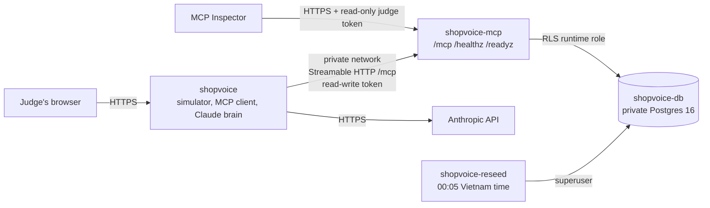

# Deploying the ShopVoice hosted demo on Render

One Blueprint (`render.yaml` at the repo root) creates everything. You paste four values once. Nothing AWS is involved.



| Service | Type | What it does |
|---|---|---|
| `shopvoice-db` | private service, `postgres:16-bookworm`, 1 GB disk | The data. It is not reachable from the internet. A private service is used because managed Render Postgres has no superuser, and migration 004 needs one (`BYPASSRLS` for the definer-function owner). |
| `shopvoice-mcp` | web, `apps/mcp-server/Dockerfile` | The MCP server at `/mcp`. Before each deploy, `node scripts/deploy/db_prepare.mjs` runs: migrations, runtime role, demo seed, tokens. The server logs in as `shopvoice_app` (`NOSUPERUSER NOBYPASSRLS`) and refuses to start as anything more privileged. |
| `shopvoice` | web, `apps/alexa-sim/Dockerfile` | The simulated Alexa+ page and its server, which is an MCP client of `shopvoice-mcp` over Render's private network. |
| `shopvoice-reseed` | cron, `5 17 * * *` (00:05 in Vietnam) | Re-anchors the demo shop to today and clears visitors' drafts. It keeps both tokens. |

## Steps (about 10 minutes)

1. **Generate the simulator token** on your PC (PowerShell or any terminal with Node 22):

   ```bash
   node -e "console.log('sv_' + require('crypto').randomBytes(32).toString('base64url'))"
   ```

   Keep it private: it can create and confirm drafts in the demo shop.
2. **Judge token.** Use the read-only value published in the README (`shopvoice-public-judge-token-read-only-2026`). It is public on purpose: it can only read the demo shop. The server refuses `create_reorder_draft` and `confirm_reorder` for it with `403 insufficient_scope`. Pasting it in step 5 is what registers it as read-only.
3. Render dashboard → **New → Blueprint** → connect GitHub → pick `vansyson1308/groceryclaw`, branch `main`. Render reads `render.yaml`.
4. Blueprint name: `shopvoice`. Region: Singapore (closest to Vietnam; all four services must share it).
5. Paste the values Render asks for (`sync: false`):

   | Key | Value |
   |---|---|
   | `SIM_MCP_TOKEN` | the token from step 1 |
   | `MCP_JUDGE_TOKEN` | the judge token from the README |
   | `ANTHROPIC_API_KEY` | your Anthropic key. Set a **spend limit** (about $30) in the Anthropic Console first |
   | `SIM_PUBLIC_MCP_URL` | `https://shopvoice-mcp.onrender.com/mcp`. If Render added a suffix to the service URL, fix this after the first deploy: shopvoice → Environment → edit → Save |

   Render generates `POSTGRES_PASSWORD` and `MCP_DB_PASSWORD` itself. Nobody has to see them.
6. **Apply.** The first deploy takes about 5–8 minutes: the database starts, then the MCP image builds, then `db_prepare` runs, then both web services come up.
7. Open `https://shopvoice.onrender.com/healthz`. You should see `"status":"ok"`.
8. Send the two URLs to the agent. It runs the checks below and writes the evidence files.

## Verify (the agent runs this; anyone can)

```bash
node scripts/demo/hosted_smoke.mjs --sim-url https://shopvoice.onrender.com \
  --mcp-url https://shopvoice-mcp.onrender.com/mcp --judge-token <judge token> --label deployed
node scripts/demo/e2e_voice_flow.mjs --sim-url https://shopvoice.onrender.com
node scripts/demo/inspector_evidence.mjs --server-url https://shopvoice-mcp.onrender.com/mcp --token <judge token> --label deployed
node scripts/demo/evals_claude.mjs --sim-url https://shopvoice.onrender.com --json-out docs/hackathon/evidence/claude-evals-hosted.json
```

`hosted_smoke.mjs` checks the following and writes `docs/hackathon/evidence/hosted-smoke-deployed.{json,md}`:

- cold start (time until both `/healthz` answer);
- the 5-phrase voice flow;
- MCP protocol `2025-11-25` with the judge token;
- that the judge token cannot draft or confirm;
- read-tool latency p50/p95.

Rehearsal: the same layout ran locally on a fresh `postgres:16-bookworm` container. See `evidence/hosted-smoke-render-rehearsal-local.md`.

## Cost (Render list prices, checked 2026-10-09 and 2026-10-22)

| Item | Plan | $/month |
|---|---|---|
| `shopvoice` web | Starter (512 MB) | 7.00 |
| `shopvoice-mcp` web | Starter | 7.00 |
| `shopvoice-db` private service | Starter | 7.00 |
| 1 GB disk | $0.25/GB | 0.25 |
| `shopvoice-reseed` cron | Starter, about 30 s a day | under 1.00 |
| **Total** | | **about $22**, under the $25 cap |

Anthropic: in the code, the simulator caps Claude at 400 turns and $2 a day (`CLAUDE_DAILY_TURN_CAP`, `CLAUDE_DAILY_BUDGET_USD`). Past either cap it answers with the offline rules brain and shows a badge, never an error page. The Console spend limit is the hard total cap, because the in-code counters reset on a redeploy.

## Cold start

Starter instances do not sleep, so there is no free-tier spin-down. The first request after a deploy may still take a second or two while the MCP client session opens. The measured number is in `hosted-smoke-deployed.md`.

## Keep it running until Dec 3

- Judging runs Nov 9–20, and the rules say the project must stay testable until judging ends. Winners come around Dec 3.
- Keep all four services on.
- Do not rotate `MCP_JUDGE_TOKEN`; it is printed in the README and the Devpost text.
- Check the Anthropic usage page once a week.

## Recreate or roll back

- Every push to `main` redeploys both web services. If `db_prepare` fails, Render keeps the previous deploy running.
- To start over, delete the Blueprint's services and apply it again; the steps above are idempotent.
